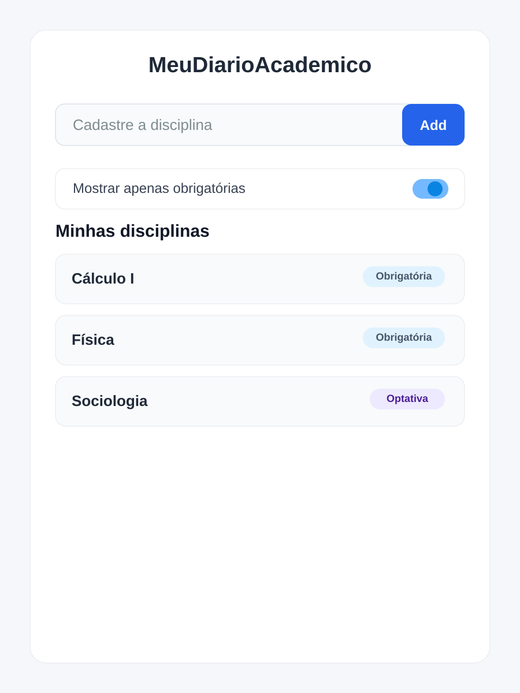
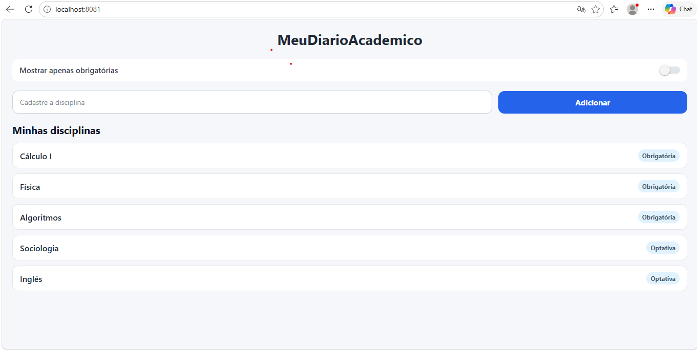
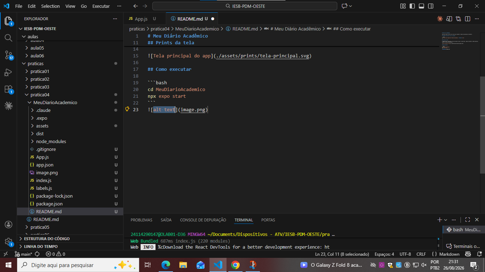

# Meu Diário Acadêmico

Aplicativo Expo com uma tela inicial para cadastro rápido de disciplinas do semestre.

## Comando usado para criar o projeto

```bash
npx create-expo-app@latest MeuDiarioAcademico --template blank
```

## Prints da tela

A imagem abaixo representa a tela principal do app, com cabeçalho, campo de cadastro, botão adicionar, switch e lista de disciplinas.



## Como executar

```bash
cd MeuDiarioAcademico
npx expo start
```

