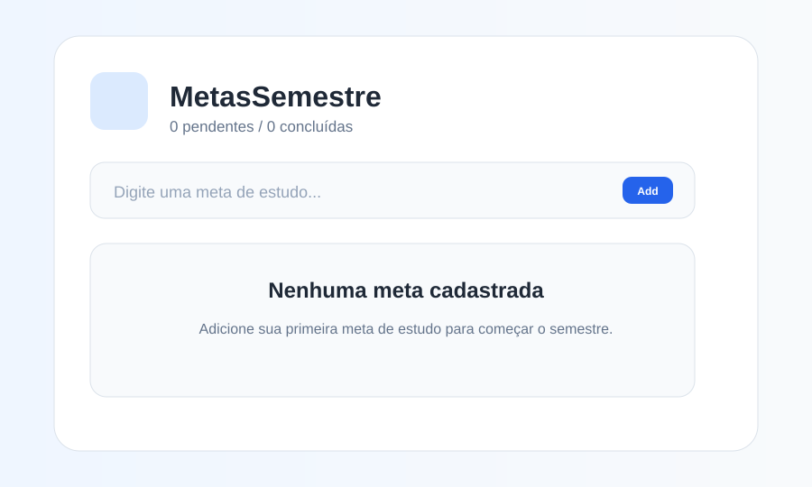
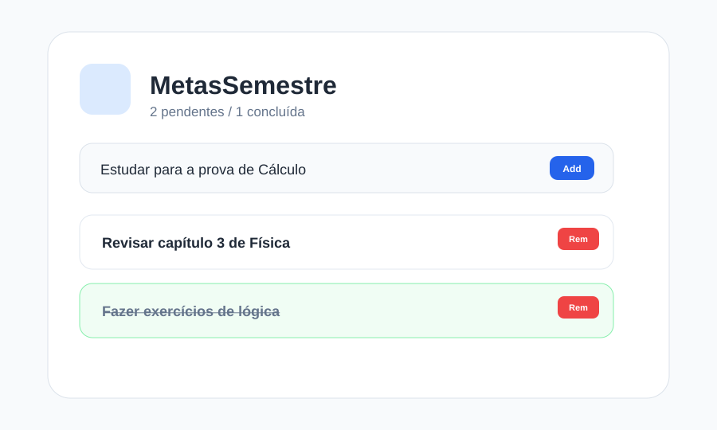
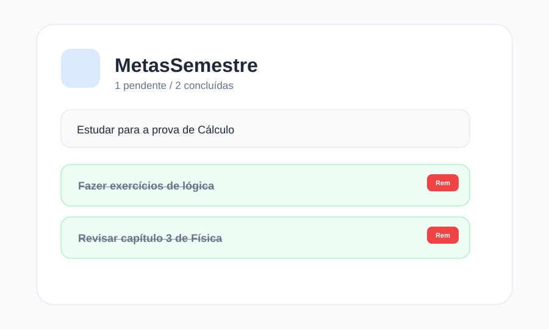

# MetasSemestre

Aplicativo de metas acadêmicas com persistência local usando `AsyncStorage`, `useState`, `useEffect` e componentes reutilizáveis.

## Funcionalidades

- Cadastro de metas de estudo
- Remoção de itens com botão específico
- Persistência das metas ao fechar e abrir o app
- Indicador de metas pendentes e concluídas
- UI com `SafeAreaView`, `FlatList` e `Pressable`

## Estrutura do código

- `App.js`: estado principal, carregamento e salvamento das metas
- `components/MetaInput.js`: input + botão para adicionar
- `components/MetaList.js`: listagem de metas com `FlatList`

## useEffect de carga e salvamento

O carregamento inicial acontece no primeiro `useEffect`, onde o app lê a chave `@metas_semestre` no `AsyncStorage` e converte o valor em JSON para restaurar a lista.

O salvamento acontece no segundo `useEffect`, que observa a variável `metas` e grava o array atualizado em JSON na mesma chave sempre que ela sofrer alteração.

## Prints





## Como executar

```bash
npm install
npx expo start
```

## Observações

A persistência funciona com a chave `@metas_semestre`, usando `JSON.stringify` para gravar e `JSON.parse` para recuperar.

## Link do Pull Request

- Ainda não publicado (preparar para envio após validação do app).
