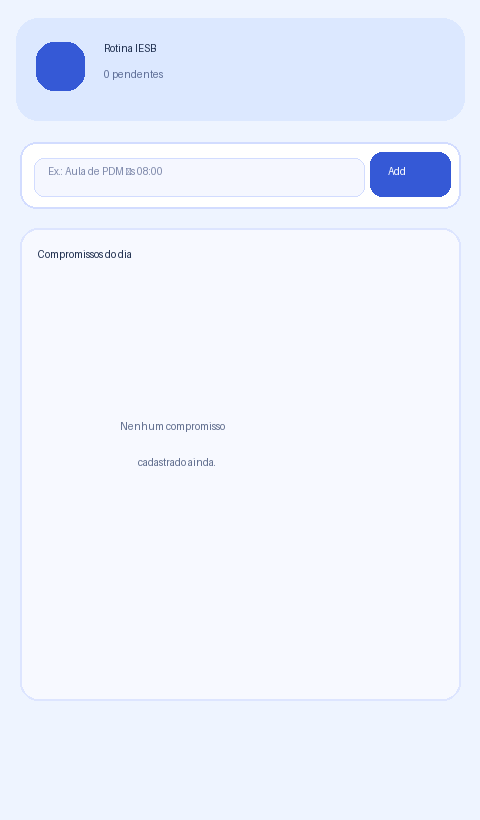
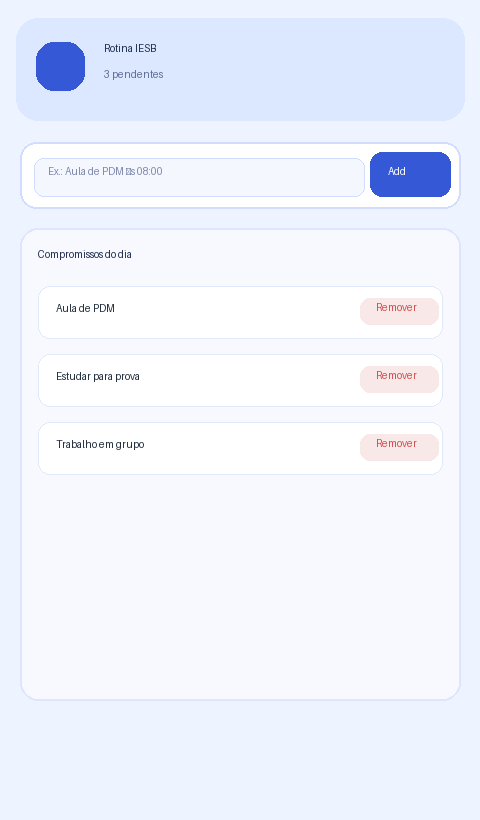
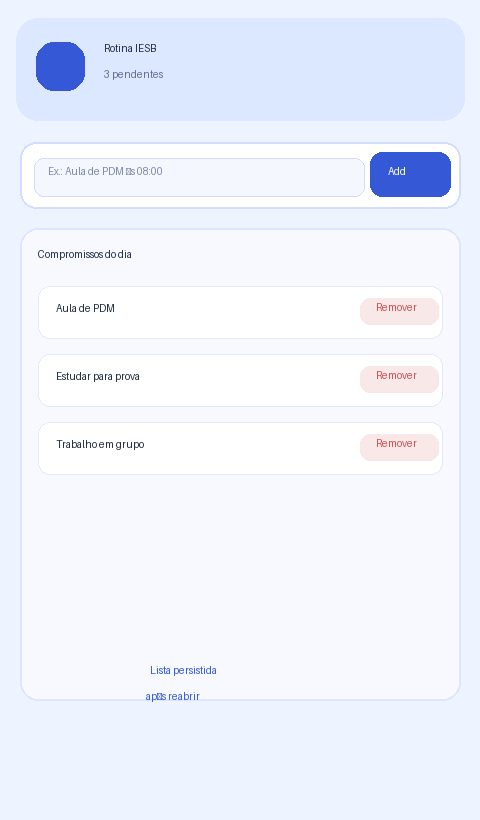

# RotinaIESB

App de organização da rotina acadêmica do aluno no IESB, com cadastro, remoção e persistência local dos compromissos.

## Comando usado para criar o projeto

```bash
npx create-expo-app@latest RotinaIESB --template blank
```

Dependências instaladas:

```bash
npx expo install @react-native-async-storage/async-storage react-native-safe-area-context
npx expo install react-dom react-native-web
```

## Prints

### Tela vazia



### Com itens



### Após reabrir o app



## Mapa do código

A persistência fica em `App.js`:

- `useEffect` de carregamento: lê a chave `@rotina_iesb_compromissos` com `AsyncStorage.getItem` e faz `JSON.parse`.
- `useEffect` de salvamento: grava a lista com `AsyncStorage.setItem` e `JSON.stringify`.

## Arquivos criados

### `labels.js`

- `tituloApp`
- `placeholderCompromisso`
- `botaoAdicionar`
- `tituloLista`
- `listaVazia`
- `alertaVazio`
- `erroCarregamento`
- `erroSalvamento`

### `components/`

- `CompromissoInput.js`
- `CompromissoList.js`

## Observações

- O app usa `SafeAreaProvider` e `SafeAreaView`.
- O layout foi organizado com `StyleSheet.create`, `flex`, `flexDirection`, `justifyContent` e `alignItems`.
- O cadastro e a remoção usam `useState`, `Pressable` e `filter` por `id`.
